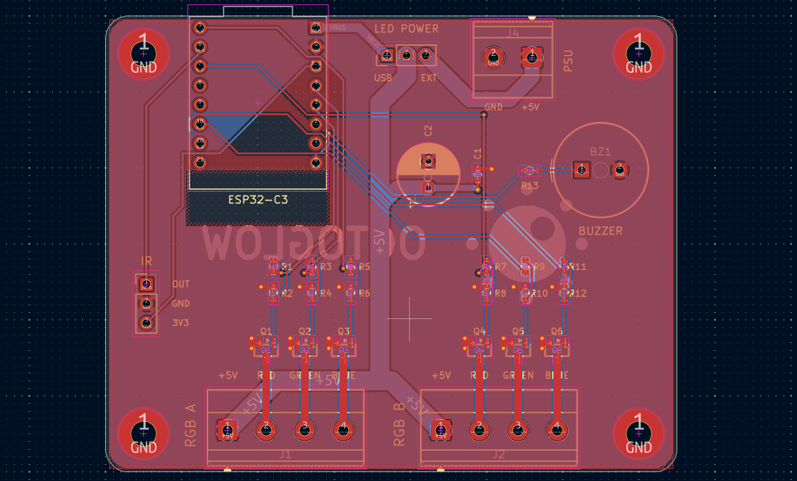
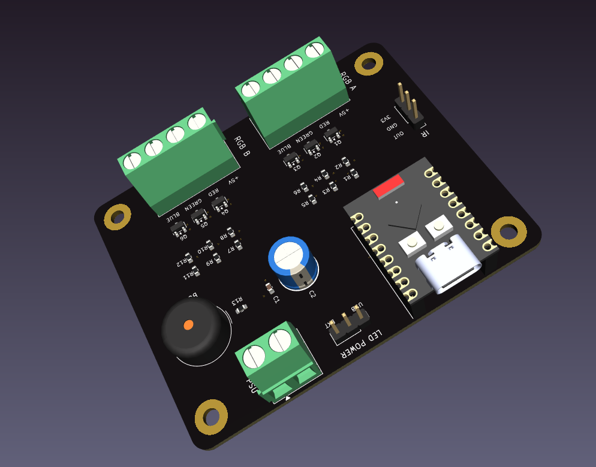
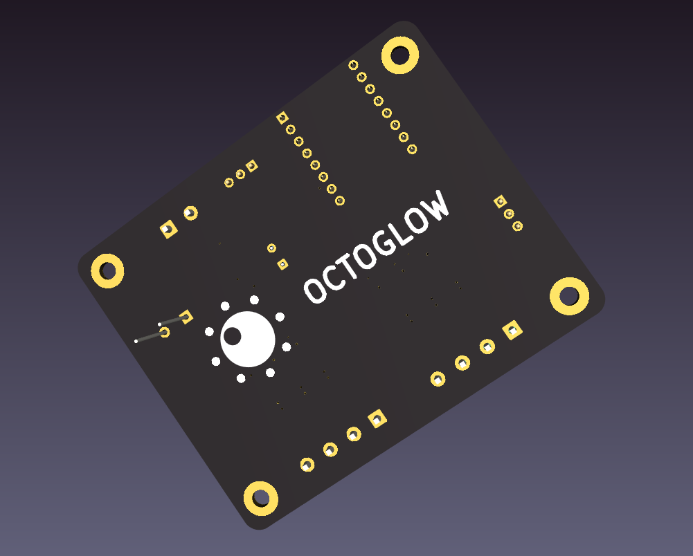
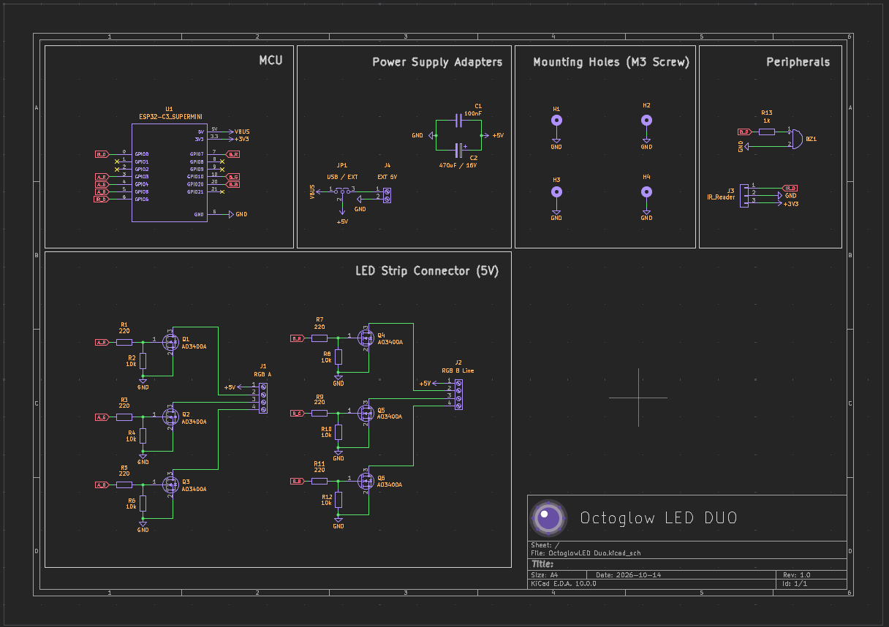

Octoglow Light Duo is an LED strip controller capable of controlling two LED strips at the same time, receiving IR signals from a remote control designed for specific controllers as well as from custom IR commands, supporting power from an external source if the power supply of the microcontroller used is too weak, and also featuring a buzzer for audible feedback

So maybe you’ve come across some cheap LED controllers that use MOSFETs, have a Bluetooth app full of ads, are unstable, and break at the slightest jolt The idea behind my project is to create a reliable version that can control two sets of LEDs, has a buzzer, an IR sensor, and dedicated software that syncs with music, notifications, and other telemetry data that a user can provide all without any ads or sketchy software, running securely on your local network.

1. Open Octoglow.ino in the Arduino IDE (You can get it form /Firmware/)
2. Install the ESP32 board package from Boards Manager, if you don't have it yet.
3. Install the required libraries from the Library Manager: `Arduino.h`
4. Select your board and the correct serial port.
5. Upload the firmware.

It requires an ESP32 C3/S3 MINI board + Octoglow firmware to function as intended.

| Component | Quantity | Unit Price (USD) | Total Price (USD) |
|:--|--:|--:|--:|
| [100 nF 50 V X7R capacitor, 0603 (C1; JLCPCB C14663)](https://jlcpcb.com/partdetail/C14663) | 5 | $0.010800 | $0.0540 |
| [AO3400A N-channel MOSFET, SOT-23 (Q1–Q6; JLCPCB C20917)](https://jlcpcb.com/partdetail/AO3400A/C20917) | 30 | $0.097100 | $2.9130 |
| [220 Ω ±1% resistor, 0603 (R1/R3/R5/R7/R9/R11; JLCPCB C22962)](https://jlcpcb.com/partdetail/0603WAF2200T5E/C22962) | 30 | $0.003300 | $0.0990 |
| [10 kΩ ±1% resistor, 0603 (R2/R4/R6/R8/R10/R12; JLCPCB C25804)](https://jlcpcb.com/partdetail/0603WAF1002T5E/C25804) | 30 | $0.002400 | $0.0720 |
| [1 kΩ ±1% resistor, 0603 (R13; JLCPCB C21190)](https://jlcpcb.com/partdetail/0603WAF1001T5E/C21190) | 5 | $0.003000 | $0.0150 |
| [KF301-2P 2-pin screw terminal block, 5 mm](https://sigmanortec.ro/Conector-PCB-2-pini-KF301-2P-5mm-p136284289) | 5 | $0.259330 | $1.2966 |
| [ESP32-C3 SuperMini development board](https://sigmanortec.ro/placa-dezvoltare-esp32-c3-supermini-33v-wifi-bluetooth) | 1 | $5.625132 | $5.6251 |
| [Passive 5 V buzzer](https://sigmanortec.ro/Buzzer-pasiv-5v-p172425809) | 1 | $0.305714 | $0.3057 |
| [PCB fabrication](https://jlcpcb.com/) | 1 | $14.067000 | $14.0670 |
| [Sigmanortec shipping (14.95 RON)](https://sigmanortec.ro/) | 1 | $3.152013 | $3.1520 |
| [JLCPCB shipping](https://jlcpcb.com/) | 1 | $16.110000 | $16.1100 |
| **GRAND TOTAL** | | | **$43.7095** |

- The firmware was never being tested
- I need to release a case for this controller after havig it
- Integrate the firmware with octoglow connect

AI contributed to this project in the following ways:
- Helped me choose efficient components for my schematics
- Helped me learn how to use a MOSFET
- Performed schematic, PCB, and DRM checks
- Was involved in firmware development 